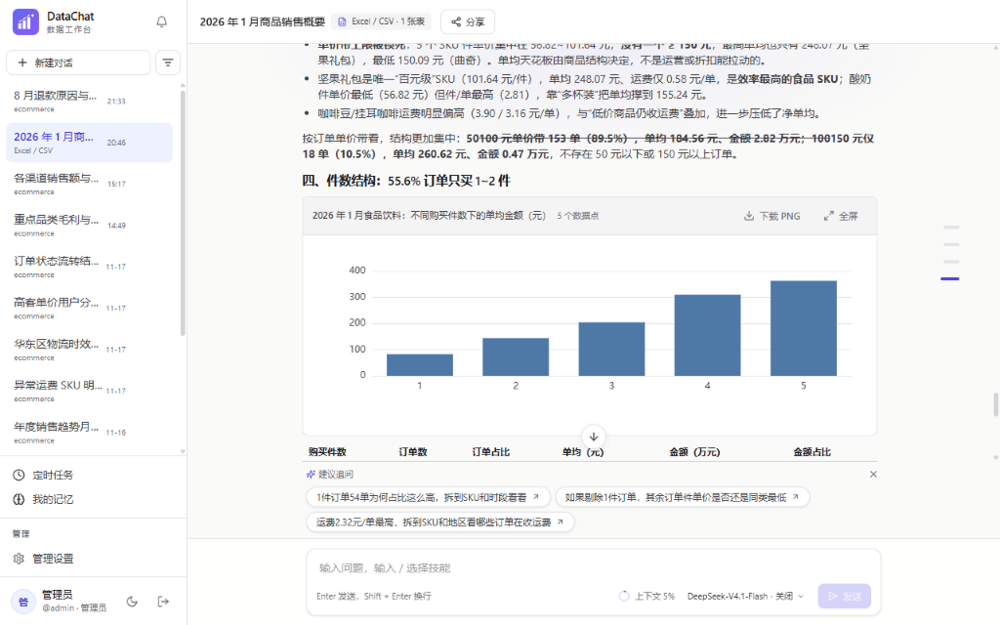
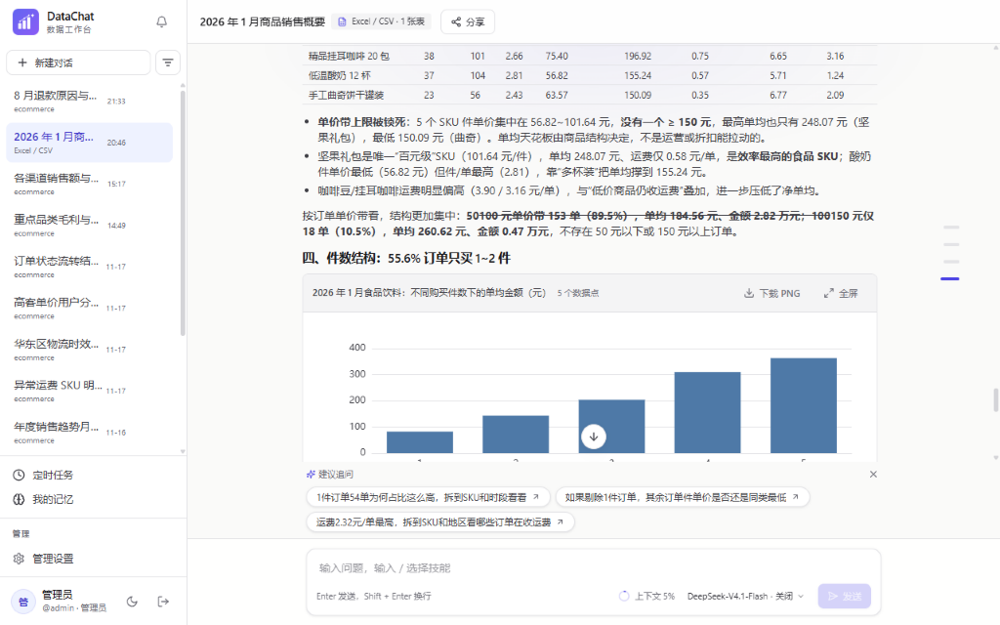

# DataChat

面向团队的对话式数据分析平台：用自然语言向 **MySQL / PostgreSQL** 提问，或直接上传 **Excel / CSV** 文件进行即席分析，自动生成只读 SQL、交互式图表、完整明细表与可分享的分析报告。

---

## 界面预览



<table>
  <tr>
    <td align="center" width="33%">
      
      <br />
      <sub><b>登录页</b></sub>
    </td>
    <td align="center" width="33%">
      
      <br />
      <sub><b>Excel / CSV 即席分析</b></sub>
    </td>
    <td align="center" width="33%">
      
      <br />
      <sub><b>数据源与只读管理</b></sub>
    </td>
  </tr>
</table>

---

## 核心特性

- **只读 NL2SQL 对话**：基于 Pi Agent 运行时，通过 `db_schema` / `db_query` / `db_explain` 探索表结构并生成查询；AST + 执行器双层只读守卫，拒绝任何写操作与危险语句。
- **Excel / CSV 即席分析**：无需预先配置数据库，新建对话即可拖拽上传 `.xlsx` / `.csv`（支持编码识别、表头行调整与多表追加 `JOIN`），在会话隔离的只读 SQLite 子进程中执行分析。
- **可视化与报告分享**：内置 ECharts 图表生成（柱/线/面积/饼/散点 + PNG 导出）、Mermaid 结构图、大结果集弹窗分页与 CSV/Excel 导出、Markdown 分析报告及可撤销/设限的匿名分享链接。
- **对话体验增强**：SSE 实时流式输出与断线按序号回放、折叠式执行过程（思考链 + SQL + 工具记录）、末轮建议追问、右侧会话导航 Minimap。
- **企业级权限与治理**：RBAC 功能权限与数据源授权、部门树与行级数据过滤（支持历史结果快照鉴权）、完整查询与管理审计、运行指标与数据保留清理。
- **可扩展生态**：支持动态模型服务管理（OpenAI-compatible / Anthropic Messages）、全局与数据源级 Skills、MCP 工具接入（`stdio` / `http`）、跨会话用户记忆与 Cron 定时任务。

---

## 技术栈与目录结构

- **后端**：Node.js ≥ 22.9、Fastify、SQLite（Drizzle ORM）、Pi Coding Agent SDK
- **前端**：React 19、TypeScript、Vite、Tailwind CSS、TanStack Query、ECharts、Mermaid
- **包管理**：pnpm Monorepo

```text
├── apps/
│   ├── server/          # Fastify API、Agent 运行时、SQL 守卫/执行器、Drizzle 迁移
│   └── web/             # React 19 + Vite 前端应用
├── packages/
│   └── shared/          # 前后端共享类型与 Zod 校验契约
├── agent/               # 系统提示词与内置分析/方言技能模板
├── evals/nl2sql/        # NL2SQL 金标评测集与评分器
├── deploy/              # Nginx 配置与部署环境变量模板
└── docs/                # 运维指南、编码规范与子系统架构参考
```

---

## 快速开始

### 1. 本地开发

**环境要求**：Node.js ≥ 22.9、pnpm 10（`corepack enable`）。

```bash
# 1. 安装依赖并构建共享包
pnpm install
pnpm -r build

# 2. 配置环境变量（APP_SECRET 至少 32 位，ADMIN_PASSWORD 至少 8 位）
cp .env.example .env

# 3. 启动前后端开发服务
pnpm dev
```

默认访问地址：
- 前端页面：`http://localhost:5173`
- 后端 API：`http://localhost:8080`

登录后可在后台「设置 → 模型服务」与「管理 → 数据源」中配置模型与数据库连接，或直接在「新建对话」选择「Excel / CSV 文件」开始分析。

### 2. Docker Compose 部署

```bash
cp deploy/env.example .env
# 编辑 .env，填写 APP_SECRET、ADMIN_PASSWORD 及实际访问的 APP_ORIGIN
docker compose up -d --build
```

默认通过 `http://localhost:5173` 访问。完整环境变量、离线镜像打包与生产注意事项请参考 [部署、配置与运维指南](docs/operations.md)。

---

## 常用命令

```bash
pnpm dev                          # 同时启动 server 与 web 开发服务
pnpm verify                       # 全量门禁：lint + typecheck + 服务端/共享测试 + Web 测试 + 构建
pnpm test                         # 运行服务端与共享包单元测试（内存 SQLite，无需外部库）
pnpm --filter @datachat/web test  # 运行前端组件测试
pnpm eval:nl2sql                  # 运行 NL2SQL 金标评测集（需 Docker 或测试库）
pnpm ops:backup                   # 备份本地 SQLite、artifact 与会话数据
```

---

## 文档导航

- [部署、配置与运维指南](docs/operations.md)：环境变量全表、Docker 部署、权限与数据范围、记忆/定时任务、备份恢复、NL2SQL 评测
- [子系统设计参考](docs/subsystems/README.md)：运行时、SQL 与 Artifact、认证权限、行级数据范围、聊天界面等模块契约
- [编码规范](docs/code-standards.md) · [开发入口](AGENTS.md) · [事故教训记录](LESSONS.md)

---

## 安全与适用边界

- **只读保证**：数据库查询仅允许 `SELECT` / `SHOW` / `DESCRIBE` / `EXPLAIN`，并经过 SQL 守卫与只读执行保护；数据源密码与外部密钥在存储时加密，绝不注入提示词或前端响应。
- **架构定位**：元数据与会话采用单机 SQLite 存储，面向中小团队内网部署与分析场景，暂不提供多租户水平扩展与自助注册。

---

## 开源协议

本项目基于 [MIT License](LICENSE) 开源。
