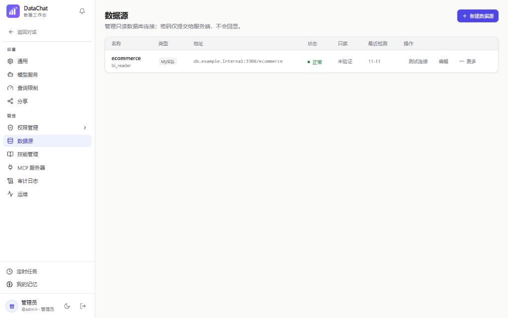

# DataChat

[](https://github.com/Fxuing/datachat/actions/workflows/ci.yml)
[](https://github.com/Fxuing/datachat/actions/workflows/docker.yml)
[](LICENSE)
[](package.json)

面向团队的开源对话式数据分析平台（ChatBI）：用自然语言向 **MySQL / PostgreSQL** 或任意自定义插件数据源提问，或直接上传 **Excel / CSV** 文件进行即席与复用分析，自动生成只读 SQL、可交互图表、个人数据看板与可分享的分析报告。

---

## 界面预览


<table>
  <tr>
    <td align="center" width="33%">
      
      <br />
      <sub><b>登录页</b></sub>
    </td>
    <td align="center" width="33%">
      
      <br />
      <sub><b>Excel / CSV 即席分析</b></sub>
    </td>
    <td align="center" width="33%">
      
      <br />
      <sub><b>数据源与只读管理</b></sub>
    </td>
  </tr>
</table>

---

## 核心特性

- **双层只读 NL2SQL 对话**：基于 Pi Agent 运行时，通过 `db_schema` / `db_query` / `db_explain` 探索表结构并生成查询；AST + 执行器双层只读守卫，拒绝任何写操作与危险函数。
- **Excel / CSV 即席与可复用数据集**：新建对话即可拖拽上传 `.xlsx` / `.csv`（自动编码识别、表头行调整、多表追加 `JOIN`），并支持一键保存为个人可复用数据集随时开启新对话。
- **轻量语义层与越用越准飞轮**：按数据源维护业务指标口径（公式、同义词、默认过滤条件）、标准表关联与 **Few-Shot 验证 SQL 示例库**；支持在后台集中查看用户点赞/点踩的问答反馈及历史 SQL，一键纠错沉淀为 Few-Shot 示例或指标，每轮按提问自动召回注入并与行级数据权限联动过滤。
- **个人数据看板与分享**：支持将任意对话图表固定至个人看板，自由切换单/双栏布局、排序重命名，查看/编辑底层只读 SQL（经守卫校验后即时重绘），支持手动一键刷新与 **Cron 定时自动刷新**（严格以所有者最新权限与行级数据范围执行），并支持生成无 SQL 泄露的只读公开分享链接（受行级数据权限门禁保护）。
- **多数据源插件标准（`@datachat/datasource-sdk`）**：内置 MySQL / PostgreSQL，提供标准驱动插件协议与一致性测试套件；支持在管理后台 **离线上传 `.mjs` / `.zip` / `.tgz` 驱动包热加载**（无需重启），或通过 `DATASOURCE_PLUGINS` 环境变量显式加载。
- **交互式可视化与报告分享**：ECharts 图表支持前端免 LLM 切换柱/线/面积/饼图、明细表切换与列排序、**点击数据点或明细行一键回填下钻追问**、PNG/CSV/Excel 导出、Mermaid 结构图、对话 Markdown 导出与历史消息编辑重发、分析报告在线编辑与公开分享。
- **企业级权限与治理**：RBAC 功能权限与数据源授权、部门树与行级数据过滤（支持历史结果快照鉴权）、完整查询与管理审计、运行指标、数据保留清理与一键备份恢复。
- **可扩展 AI 生态**：动态多模型服务管理（OpenAI-compatible / Anthropic Messages）、全局与数据源级 Skills、MCP 工具接入（`stdio` / `http`）、跨会话用户记忆与 Cron 定时任务。

---

## 技术栈与目录结构

- **后端**：Node.js ≥ 22.9、Fastify、SQLite（Drizzle ORM）、Pi Coding Agent SDK
- **前端**：React 19、TypeScript、Vite、Tailwind CSS、TanStack Query、ECharts、Mermaid
- **包管理**：pnpm Monorepo

```text
├── apps/
│   ├── server/          # Fastify API、Agent 运行时、SQL 守卫/执行器、Drizzle 迁移
│   └── web/             # React 19 + Vite 前端应用
├── packages/
│   ├── datasource-sdk/  # 多数据源驱动插件标准协议（@datachat/datasource-sdk）
│   └── shared/          # 前后端共享类型与 Zod 校验契约
├── examples/
│   ├── driver-clickhouse/  # 零依赖 ClickHouse HTTP 参考插件（可直接后台离线上传）
│   └── driver-trino/       # 零依赖 Trino HTTP 参考插件（可直接后台离线上传）
├── agent/               # 系统提示词与内置分析/方言技能模板
├── evals/nl2sql/        # NL2SQL 金标评测集与评分器
├── deploy/              # Dockerfile、Nginx 配置、Demo 初始化脚本与环境变量模板
└── docs/                # 运维指南、插件开发指南、编码规范与子系统架构参考
```

---

## 快速开始

### 1. Docker 预构建镜像极速启动（推荐，无需克隆源码）

已发布 `linux/amd64` 与 `linux/arm64` 多架构官方镜像，直接拉取即可运行：

| 镜像源 | Server 镜像 | Web 镜像 |
| --- | --- | --- |
| **Docker Hub（默认）** | `fxuing/datachat-server:latest` | `fxuing/datachat-web:latest` |
| **GitHub Container Registry** | `ghcr.io/fxuing/datachat-server:latest` | `ghcr.io/fxuing/datachat-web:latest` |

```bash
mkdir datachat && cd datachat
curl -fsSLO https://raw.githubusercontent.com/Fxuing/datachat/main/docker-compose.yml
curl -fsSL https://raw.githubusercontent.com/Fxuing/datachat/main/deploy/env.example -o .env

# 1. 编辑 .env：填写 APP_SECRET（>=32 字符，可用 openssl rand -hex 32 生成）和 ADMIN_PASSWORD（>=8 字符）
#    如需改用 GHCR，将 IMAGE_PREFIX 改为 ghcr.io/fxuing/
# 2. 启动服务（默认映射 http://localhost:5173）
docker compose up -d
```

打开浏览器访问 `http://localhost:5173`，使用 `ADMIN_USERNAME` / `ADMIN_PASSWORD` 登录；如需升级版本，执行 `docker compose pull && docker compose up -d` 即可（数据持久化在 `datachat-data` 卷中）。

完整环境变量、离线镜像导入、备份恢复及从源码构建（`docker compose up -d --build`）请参考 [部署、配置与运维指南](docs/operations.md)。

### 2. 一键 Demo 沙箱（含只读 PostgreSQL 示例库 + 语义层 + 示例看板）

适合 1 分钟快速体验完整流程（仅限本地评估使用）：

```bash
git clone https://github.com/Fxuing/datachat.git && cd datachat

# 启动 Demo PostgreSQL + DataChat 服务端与前端（默认直接拉取预构建镜像；改过源码可加 --build）
docker compose -f docker-compose.demo.yml up -d

# 注入示例数据源、3 条业务指标、3 条表关联和 1 个可刷新示例看板
docker compose -f docker-compose.demo.yml exec server node apps/server/dist/cli/seed-demo.js
```

打开 `http://localhost:5173`，使用默认 Demo 账号 `admin` / `datachat-demo` 登录：
- 可直接进入 **「数据看板」** 点击卡片右上角 **「刷新」** 验证实时只读 SQL 重跑；
- 在 **「设置 → 模型服务」** 填入任意 OpenAI 兼容或 Anthropic API Key 后，即可对「电商示例库（Demo）」直接对话提问。

### 3. 本地开发

**环境要求**：Node.js ≥ 22.9、pnpm 10（`corepack enable`）。

```bash
pnpm install
pnpm -r build
cp .env.example .env   # 填写 APP_SECRET（>=32 字符）和 ADMIN_PASSWORD（>=8 字符）
pnpm dev
```

默认访问地址：前端 `http://localhost:5173`，后端 API `http://localhost:8080`。

---

## 数据源驱动插件生态

DataChat 内置 **MySQL** 和 **PostgreSQL**，其他数据库可通过标准协议包 `@datachat/datasource-sdk` 无侵入扩展（所有插件 SQL 均强制经过核心 AST 只读守卫）：

| 驱动 | 类型 | 位置 / 说明 |
| --- | --- | --- |
| **MySQL** | 内置 | 核心默认支持（含只读检测、`EXPLAIN`、行级权限） |
| **PostgreSQL** | 内置 | 核心默认支持（含只读检测、`EXPLAIN`、行级权限） |
| **ClickHouse** | 参考插件 | [`examples/driver-clickhouse/`](examples/driver-clickhouse/)（零依赖 HTTP `.mjs`，支持后台直接离线上传） |
| **Trino** | 参考插件 | [`examples/driver-trino/`](examples/driver-trino/)（零依赖 HTTP `.mjs`，支持 Hive/Iceberg 联邦查询） |

编写或接入你自己的数据源驱动（如 StarRocks、Doris、SQL Server、Oracle、DuckDB 等），请阅读 [数据源驱动插件开发指南](docs/datasource-plugin-guide.md)。

---

## 常用命令

```bash
pnpm dev                          # 同时启动 server 与 web 开发服务
pnpm verify                       # 全量门禁：lint + typecheck + 服务端/SDK/共享测试 + Web 测试 + 构建
pnpm test                         # 运行服务端、SDK 与共享包单元测试（内存 SQLite，无需外部库）
pnpm --filter @datachat/web test  # 运行前端组件测试
pnpm demo:seed                    # 向本地 SQLite 注入 Demo 数据源、语义层与示例看板
pnpm eval:nl2sql                  # 运行 NL2SQL 金标评测集（需 Docker 或测试库）
pnpm ops:backup                   # 备份本地 SQLite、artifact、会话与已上传插件
```

---

## 文档导航

- [部署、配置与运维指南](docs/operations.md)：环境变量全表、Docker 部署与自动发版、权限与数据范围、记忆/定时任务、备份恢复、NL2SQL 评测
- [开放平台接入指南](docs/open-platform-guide.md)：API Key、结构化问答/报告 API、行级权限透传、远程 MCP Server、Webhook 验签与在线文档 `/open-docs`
- [数据源驱动插件开发指南](docs/datasource-plugin-guide.md)：`@datachat/datasource-sdk` 协议、一致性测试、离线上传与环境变量加载
- [子系统设计参考](docs/subsystems/README.md)：运行时、SQL 与 Artifact、认证权限、行级数据范围、聊天界面等模块契约
- [编码规范](docs/code-standards.md) · [开发入口](AGENTS.md) · [事故教训记录](LESSONS.md)

---

## 开源协议

本项目基于 [MIT License](LICENSE) 开源。
