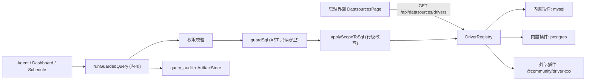

# 第三阶段设计方案：多数据源驱动插件化标准（`@datachat/datasource-sdk`）

日期：2026-11-22  
状态：待评审（Proposal）

---

## 1. 背景与目标

当前 DataChat 的数据源能力（探测、内省、连接池、只读查询执行、SQL 守卫、行级范围改写与前端表单）直接写死了 `mysql` 与 `postgres` 两套分支：

- 共享校验：[`packages/shared/src/index.ts`](../../../packages/shared/src/index.ts)（`datasourceTypeSchema = z.enum(["mysql", "postgres"])`）
- 连接与探测：[`pool.ts`](../../../apps/server/src/agent/datasource/pool.ts)、[`probe.ts`](../../../apps/server/src/agent/datasource/probe.ts)
- Schema 内省：[`introspect.ts`](../../../apps/server/src/agent/datasource/introspect.ts)
- SQL 守卫、范围改写与执行器：[`guard.ts`](../../../apps/server/src/agent/sql/guard.ts)、[`scope.ts`](../../../apps/server/src/agent/sql/scope.ts)、[`executor.ts`](../../../apps/server/src/agent/sql/executor.ts)
- 前端管理页与聊天页标签：硬编码 `type === "mysql" ? "MySQL" : "PostgreSQL"`

企业与开源社区常见需求包括 ClickHouse、StarRocks / Doris、DuckDB、SQL Server、Oracle、Snowflake 等。核心仓库不应背负所有数据库驱动的依赖与维护成本。

### 本阶段目标

1. **定义标准驱动 SDK（`packages/datasource-sdk` / `@datachat/datasource-sdk`）**：提供零重依赖的 TypeScript 接口、工具函数与一致性测试套件，让社区或企业内部只需实现一个轻量 npm 包即可接入新数据源。
2. **安全边界全部由 DataChat 内核统一兜底**：插件不能绕过只读 AST 守卫、SSRF 阻断、凭据加密、数据源授权、行级数据权限改写、查询上限与审计日志。
3. **内置 MySQL / PostgreSQL 迁移为标准参考实现**：用真实生产驱动验证 SDK 契约的完备性，同时确保已有部署 100% 向后兼容。
4. **前端零硬编码扩展**：前端通过后端暴露的驱动清单自动渲染数据源类型选项、默认端口、SSL 开关与扩展配置字段。

### 非目标（本阶段不做）

- 不在核心仓库内维护 ClickHouse / Oracle / SQL Server 等第三方驱动实现（只提供一个最小参考模板或文档示例）。
- 不支持运行时从 Web 界面动态下载/执行未知远程代码（插件只允许由运维通过显式白名单安装加载）。
- 不把「上传 Excel / CSV 临时 SQLite 会话」强行并入外部数据源插件体系（它属于会话级隔离沙箱，继续留在内核）。

---

## 2. 核心原则与安全边界

> **一条铁律：插件负责“连接、内省、流式执行与方言声明”，内核负责“一切安全与治理”。**

| 职责 | 归属 | 说明 |
| --- | --- | --- |
| SSRF / 危险地址拦截（`isBlockedDatasourceHost`） | **内核** | 创建/测试/连接前统一校验，插件拿不到未校验地址 |
| 密码与敏感配置加解密（AES-GCM + `APP_SECRET`） | **内核** | 插件仅在运行期拿到解密后的连接参数；日志/报错经 `safeErrorMessage` 统一脱敏 |
| 用户 / 部门 / 数据源授权（`authorizeDatasourceAccess`） | **内核** | 每次查询与 schema 刷新前由内核重查数据库 |
| 只读 SQL AST 守卫（`guardSql`） | **内核** | 使用插件声明的方言 + 额外禁用函数/系统库列表，拦截写操作/多语句/加锁读/危险函数 |
| 部门行级数据权限改写（`applyScopeToSql`） | **内核** | 内核完成 AST 改写与参数化绑定，按插件声明的占位符风格输出参数 |
| 查询行数上限（`maxRows`）、超时（`AbortSignal`）、Artifact 落盘、审计日志 | **内核** | 即使插件吐出超量行，内核流式消费器仍会在 `maxRows` 处截断并中止流 |
| 连接探测（探活 + 版本号 + 只读账号检查） | **插件** | 返回 `{ ok, serverVersion, readOnly, warnings, error }` |
| 连接池管理（创建、会话级只读参数、关闭销毁） | **插件** | 建立连接时应在驱动层再设会话级只读（纵深防御） |
| Schema 内省（表/列/注释/主键/索引/外键） | **插件** | 归一化为标准 `SchemaSnapshot` |
| 只读流式执行（`executeQuery`） | **插件** | 接收内核改写后的 SQL + `params` + `signal`，分批吐出 `{ columns, rows }` |
| 方言元数据与 Prompt 提示 | **插件** | 声明 parser 方言、占位符风格、额外禁用函数、简短 SQL 方言要点 |

---

## 3. 整体架构



### 与现有表结构的兼容性

检查现有 [`apps/server/src/db/schema.ts`](../../../apps/server/src/db/schema.ts)：
- `datasources.type` 在 SQLite 表定义中**没有 `CHECK` 约束**（`enum` 仅在 TypeScript 层），因此放开为任意已注册的驱动 ID（正则 `/^[a-z][a-z0-9_-]{1,31}$/`）**不需要重建 `datasources` 表**。
- `datasources.options_json` 列**已经存在**，可直接用于存放插件扩展配置（非敏感项明文 JSON；敏感项由内核按字段 `secret: true` 加密后存入独立密文字段或加密信封，避免任何凭据明文落盘）。

---

## 4. `@datachat/datasource-sdk` 核心接口规范

新增 workspace 包 `packages/datasource-sdk`（对外可独立发布为 `@datachat/datasource-sdk`），导出以下稳定契约（`SDK_API_VERSION = 1`）：

### 4.1 驱动清单与配置表单（`DatasourceDriverManifest`）

```ts
export const DATASOURCE_SDK_VERSION = 1 as const;

export type ConnectionMode = "network" | "file" | "uri";

export type OptionFieldSchema =
  | {
      key: string;
      label: string;
      type: "text" | "number" | "boolean";
      required?: boolean;
      secret?: boolean; // 设为 true 时由内核 AES-GCM 加密存储，列表接口脱敏不回传
      defaultValue?: string | number | boolean;
      placeholder?: string;
      description?: string;
    }
  | {
      key: string;
      label: string;
      type: "select";
      required?: boolean;
      defaultValue?: string;
      options: Array<{ value: string; label: string }>;
      description?: string;
    };

export interface DatasourceDriverCapabilities {
  /** 是否支持 EXPLAIN 执行计划（控制 db_explain 工具是否可用） */
  explain: boolean;
  /** 是否支持在探活阶段识别账号只读权限（否则 readOnly=false，需管理员勾选 allowWriteAccount） */
  readOnlyProbe: boolean;
  /** 是否支持部门行级数据权限 AST 改写与参数化查询 */
  rowScope: boolean;
}

export interface DatasourceDriverManifest {
  sdkVersion: typeof DATASOURCE_SDK_VERSION;
  /** 唯一驱动标识，如 "mysql" / "postgres" / "clickhouse" / "mssql" */
  id: string;
  /** 展示名称，如 "ClickHouse" / "Apache Doris" */
  label: string;
  /** 连接模式：标准 host/port/database，或本地只读文件（如 DuckDB），或自定义 URI */
  connectionMode: ConnectionMode;
  defaultPort?: number;
  supportsSsl: boolean;
  /** 动态渲染在管理后台「数据源表单」里的扩展字段 */
  optionsSchema: OptionFieldSchema[];
  capabilities: DatasourceDriverCapabilities;
}
```

### 4.2 方言声明（`DialectProfile`）

```ts
export type AstParserDialect =
  | "mysql"
  | "postgresql"
  | "sqlite"
  | "transactsql"
  | "bigquery"
  | "snowflake"
  | "hive"
  | "mariadb"
  | "flinksql"
  | "redshift"
  | "trino"
  | "athena";

export type PlaceholderStyle =
  | "qmark"   // ?（MySQL / SQLite / ClickHouse / Doris）
  | "dollar"  // $1, $2（PostgreSQL / DuckDB）
  | "at"      // @p1, @p2（SQL Server）
  | "colon";  // :1, :2（Oracle）

export interface DialectProfile {
  /** 传给内核 node-sql-parser 的语法方言 */
  parserDialect: AstParserDialect;
  /** 行级权限改写使用的参数占位符风格 */
  placeholderStyle: PlaceholderStyle;
  /** 标识符引用方式，用于错误提示和改写辅助 */
  quoteChar: "`" | '"' | "[";
  /** 插件追加的危险函数黑名单（与内核全局黑名单合并） */
  extraForbiddenFunctions?: string[];
  /** 插件追加的系统 schema 黑名单（与内核全局黑名单合并，如 ClickHouse 的 "system"） */
  extraSystemSchemas?: string[];
  /**
   * 可选：注入到系统 Prompt 的简短方言要点（上限 800 字），
   * 例如 ClickHouse 的日期函数、大小写敏感规则等。
   */
  promptGuidance?: string;
}
```

### 4.3 运行时驱动接口（`DatasourceDriver` 与 `DatasourceDriverPool`）

```ts
export interface ResolvedConnectionConfig {
  id: string;
  type: string;
  host: string;
  port: number;
  database: string;
  username: string;
  password: string;
  sslMode: "disable" | "require" | "no-verify";
  /** 已通过 optionsSchema 校验并解密 secret 字段后的扩展选项 */
  options: Record<string, string | number | boolean | undefined>;
}

export interface ProbeResult {
  ok: boolean;
  serverVersion?: string;
  readOnly: boolean;
  warnings: string[];
  error?: string;
}

export interface NormalizedColumn {
  name: string;
  type: "string" | "number" | "boolean" | "date" | "json" | "unknown";
}

export interface QueryBatch {
  columns: NormalizedColumn[];
  rows: unknown[][];
}

export interface QueryExecutionRequest {
  /** 已经过 guardSql 与（如启用）行级范围改写的只读 SQL */
  sql: string;
  /** 与占位符一一对应的绑定参数 */
  params: unknown[];
  /** 建议单次批量吐出的行数提示 */
  batchSize: number;
  /** 最大返回行数（内核仍会二次截断兜底） */
  maxRows: number;
  timeoutMs: number;
  signal?: AbortSignal;
}

export interface DatasourceDriverPool {
  introspect(signal?: AbortSignal): Promise<SchemaSnapshot>;
  executeQuery(
    request: QueryExecutionRequest,
    emitBatch: (batch: QueryBatch) => Promise<void>,
  ): Promise<void>;
  close(): Promise<void>;
}

export interface DatasourceDriver {
  readonly manifest: DatasourceDriverManifest;
  readonly dialect: DialectProfile;

  /** 短连接探测（不进连接池，完成后必须释放连接） */
  probe(config: ResolvedConnectionConfig, signal?: AbortSignal): Promise<ProbeResult>;

  /** 创建数据源级连接池实例（由内核 PoolRegistry 缓存与驱逐） */
  createPool(config: ResolvedConnectionConfig): DatasourceDriverPool;

  /**
   * 可选：把驱动原生错误归一化为标准错误分类（如超时 / 中止），
   * 未实现时内核按默认 SQL_ERROR 处理并经 safeErrorMessage 脱敏。
   */
  classifyError?(error: unknown): "timeout" | "aborted" | "sql_error";
}
```

---

## 5. SQL 守卫、方言与行级数据权限适配

### 5.1 只读守卫（`guardSql`）扩展

- 将 [`guard.ts`](../../../apps/server/src/agent/sql/guard.ts) 的 `GuardInput` 从硬编码 `dialect: "mysql" | "postgres" | "sqlite"` 升级为接收 `DialectProfile`（同时保留对旧字符串的兼容包装）。
- 合并策略：
  - `forbiddenFunctions = GLOBAL_FORBIDDEN_FUNCTIONS ∪ dialect.extraForbiddenFunctions`（例如 ClickHouse 插件声明 `url`、`remote`、`remoteSecure`、`file`、`s3`、`hdfs`、`jdbc`、`mysql`、`postgresql` 等外部表函数）。
  - `systemSchemas = GLOBAL_SYSTEM_SCHEMAS ∪ dialect.extraSystemSchemas`（例如 ClickHouse 的 `system`、`information_schema`）。
- 任何超出 `node-sql-parser` 解析能力的语法一律 **fail-closed（返回 `PARSE_ERROR`）**，绝不放行未解析语句。

### 5.2 行级数据权限（`applyScopeToSql`）适配

- 当插件声明 `capabilities.rowScope === true`：
  - 内核按 `dialect.parserDialect` 解析并改写 AST，按 `dialect.placeholderStyle` 生成绑定占位符（`?` / `$1` / `@p1` / `:1`），将 `params` 原样传给 `pool.executeQuery`。
- 当插件声明 `capabilities.rowScope === false`（例如某些非标准 SQL 引擎暂不支持参数化 AST 改写）：
  - 管理界面在「行级权限」页**禁止**对该数据源启用 `dataScopeMode = "enabled"`，明确提示“当前驱动暂不支持行级数据权限”；
  - 服务端亦同步拒绝（`400 SCOPE_UNSUPPORTED_BY_DRIVER`），绝不静默跳过过滤。

### 5.3 EXPLAIN 与只读账号校验

- `db_explain` 工具在执行前检查 `driver.manifest.capabilities.explain`，为 `false` 时返回清晰提示而非发送无效 SQL。
- 若驱动 `capabilities.readOnlyProbe === false`（某些协议无法自检权限），`probe()` 返回 `readOnly: false` 并附告警，管理员显式确认 `allowWriteAccount = true` 后方可启用，查询仍强制经过内核只读 AST 守卫。

---

## 6. 插件发现、加载与容错机制

### 6.1 显式白名单加载（安全优先）

不在运行时盲扫整个 `node_modules`，仅通过显式配置加载插件：

1. **环境变量**：`DATASOURCE_PLUGINS`（逗号分隔的 npm 包名或相对/绝对路径，例如 `DATASOURCE_PLUGINS=@datachat/driver-clickhouse,./plugins/driver-doris/index.js`）。
2. **启动加载流程（`loadDatasourceDrivers`）**：
   - 先注册内置驱动：`mysql`、`postgres`。
   - 逐个动态 `import()` 白名单中的模块，读取默认导出或具名导出 `driver`（或 `drivers` 数组）。
   - 严格校验：
     - `manifest.sdkVersion === 1`（版本不匹配立即报错拒绝加载）；
     - `manifest.id` 符合 `/^[a-z][a-z0-9_-]{1,31}$/` 且不与已注册驱动重名（防止覆盖内置驱动）；
     - 必需方法 `probe`、`createPool` 与合法 `dialect` 完整存在。
   - 加载失败记录结构化错误日志；通过 `DATASOURCE_PLUGINS_STRICT=true` 可选择“插件加载失败即终止启动”（生产推荐），默认模式下跳过失败插件并记录告警。

### 6.2 插件卸载 / 缺失时的受控降级

如果数据库里已经存有一条 `type = "clickhouse"` 的数据源，但重启时管理员移除了该插件：
- **服务仍正常启动**，已有其他数据源不受影响；
- 数据源列表接口正常返回该行，并附带 `driverAvailable: false` 状态提示；
- 对该数据源发起查询、测试连接、刷新 schema 或看板刷新时，内核统一返回受控错误 `503 DRIVER_NOT_INSTALLED`（`未安装「clickhouse」数据源驱动插件`），绝不崩溃或回退到错误方言。

---

## 7. 前端动态适配方案

1. **新增只读元数据接口**：`GET /api/datasources/drivers`（需登录）
   - 返回所有已注册驱动的 `manifest`（脱敏：不包含任何运行时函数或内部路径）与 `builtin: boolean`。
2. **数据源管理页（`DatasourcesPage` / `DatasourceEditor`）**：
   - 下拉列表由 `/api/datasources/drivers` 动态生成；切换驱动时自动填充 `defaultPort`（沿用现有的“未手工修改端口时才自动切换”逻辑）。
   - 根据 `supportsSsl` 控制是否展示 SSL 选项；根据 `connectionMode` 调整主机/路径输入标签。
   - 根据 `optionsSchema` 动态渲染扩展表单项（文本 / 数字 / 开关 / 下拉 / 密码框）；编辑已有数据源时，`secret: true` 字段留空表示保留原值（与 `password` 一致）。
   - 对 `driverAvailable === false` 的数据源展示黄色「驱动未安装」徽标并禁用测试/刷新操作。
3. **聊天页 / 看板 / 语义层**：
   - 将所有 `type === "mysql" ? "MySQL" : "PostgreSQL"` 替换为从驱动清单查 `driver.label`（查不到时回退显示 `type` 原值）。

---

## 8. 第三方插件开发体验与一致性测试套件

为了让社区开发者 30 分钟就能写出高质量驱动，`@datachat/datasource-sdk` 配套提供：

1. **`defineDatasourceDriver(driver)`**：提供完整 TypeScript 类型推断与基础 manifest 校验。
2. **`normalizeColumnType(rawType)`**：通用 SQL 类型名归一化辅助函数（把 `Int64` / `Decimal(18,2)` / `DateTime64` / `JSONB` 等统一映射到 `NormalizedColumn["type"]`）。
3. **`createDriverConformanceSuite(options)`**（Vitest 测试工厂）：
   - 插件作者只需传入自己的 `driver` 和测试连接配置，即可一键跑完官方合规测试：
     - 探活成功/失败（且错误消息不泄露密码）；
     - Schema 内省结构合法性；
     - 流式查询返回正确列与行，且在 `maxRows` 处正确停止；
     - `AbortSignal` 取消查询能及时释放连接；
     - 写操作在会话级只读配置下被拒绝；
     - 连接池 `close()` 后无句柄泄漏。
4. **文档与模板**：新增 `docs/datasource-plugin-guide.md`，附一个完整的外部驱动脚手架示例（如 ClickHouse HTTP 驱动结构示范）。

---

## 9. 分步实施计划（建议拆成 3 个独立 PR / Commit）

| 阶段 | 内容 | 验证重点 |
| --- | --- | --- |
| **Step 1：SDK 包 + 驱动注册表 + 内置 MySQL/PG 迁移** | 新建 `packages/datasource-sdk`；建立 `DriverRegistry`；将现有 `mysql`/`postgres` 迁入 `apps/server/src/drivers/`；改造 `PoolRegistry`、`probeDatasource`、`introspect`、`guardSql`、`scope.ts`、`executor.ts` 与 `prompt.ts` 走统一驱动抽象 | 现有全部 MySQL/PG 单测 + `RUN_DB_TESTS=1` 集成测试全绿，行为零回退 |
| **Step 2：插件白名单加载器 + `options_json` 密文支持 + 缺失驱动降级** | 实现 `DATASOURCE_PLUGINS` 动态加载与 manifest 校验；支持 `optionsSchema` 校验与 `secret` 字段加密；处理 `DRIVER_NOT_INSTALLED` 降级 | 新增假外部插件加载测试、错误版本/重名拒绝测试、secret 加密不回传测试 |
| **Step 3：前端动态驱动表单 + 插件开发指南** | 暴露 `GET /api/datasources/drivers`；改造 `DatasourcesPage` / `DatasourceEditor` / `ChatPage` 去除方言硬编码；补充 `docs/datasource-plugin-guide.md` 与一致性测试套件 | Web 组件测试（含自定义插件的动态扩展字段表单渲染与提交）+ 全量 `pnpm verify` |

---

## 10. 需要你确认的几个决策点

1. **非网络型数据源（如本地 DuckDB / SQLite 文件）**：首版是否需要同步支持 `connectionMode: "file"`（需要额外规定白名单目录以防任意路径读取），还是首版先聚焦标准网络数据库（`network`），安全边界更清晰？
2. **第三方插件扩展配置里的敏感字段（`secret: true`）**：是否首版就支持按字段加密存进 `options_json`（如 BigQuery Service Account JSON / Token），还是先复用 `password` 字段、后续按需扩展？
3. **仓库内是否附带一个示例外部插件（例如 `examples/driver-clickhouse` 骨架或完整可用 demo）**，方便开源后社区照抄？
